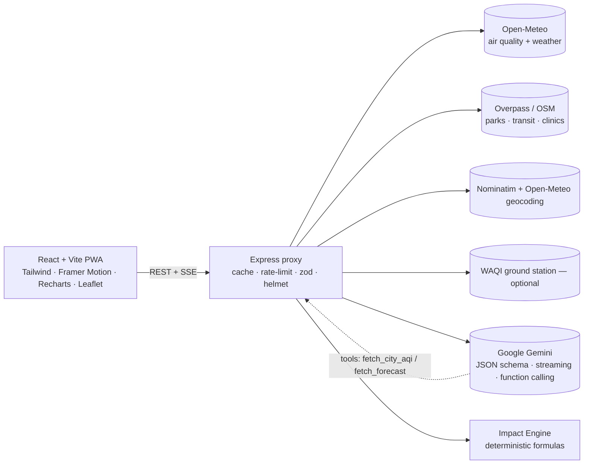

# 🌿 AirAlly — Urban Air Quality Assistant

GenAI-powered assistant that helps families and communities cope with severe winter smog: live air data → personalised hour-by-hour routines → indoor hacks → sustainable alternatives → a **deterministic Impact Engine** that shows the direct effect of each choice, with Gemini explaining the numbers in plain language.

> Built for PromptWars Virtual Challenge 6. **No mock data anywhere** — every number is live API data or a documented formula applied to it. If a source fails, the UI shows an error with a retry button.

## Architecture



API keys live only on the server. The profile (household, health flags, lifestyle) is stored in the browser's localStorage; the server never stores or logs it and receives only a minimal subset per AI request.

## Features
| | |
|---|---|
| Onboarding | 3 steps, detect/search any city, ≤5 saved locations, household age groups + sensitivities, lifestyle, EN/हिं |
| Dashboard | US AQI gauge, India NAQI (CPCB), pollutants vs WHO 2021, 24 h + 5-day chart with cleanest-hour bands, weather + boundary layer, AI "why is it bad", Leaflet map + nearest transit/park/clinic, WAQI ground-station vs model |
| AI Daily Plan | Gemini structured JSON (zod-validated, 1 retry). Hourly PM2.5 and windows are re-attached from real forecast by code |
| Indoor hacks | Ranked actions, skip-list, Corsi–Rosenthal steps, CADR/ACH room calculator, HEPA filter tracker |
| Alternatives | Names the real nearby metro/bus/cycle stand found via Overpass; honest time/cost tradeoffs |
| Impact | Before/after exposure bars, weekly "exposure saved" + cumulative CO₂ from choices you mark done, "How we calculated this" panel |
| Chat | Streaming Gemini with live context, function calling for any city, suggested chips, voice in / read-aloud |
| Alerts & community | In-app + browser notifications (while app is open), shareable report image + Web Share, compare up to 4 cities |
| PWA / a11y | Installable, app-shell caching, colour-blind-safe palette with text labels, keyboard nav, reduced motion, dark/light |

## Impact Engine (server/src/routes/impact.ts)
- **Dose** (µg) = concentration (µg/m³) × inhalation rate (m³/h) × hours
- Concentration = ambient × (commute-mode factor **or** indoor/outdoor ratio) × (1 − mask efficiency)
- Inhalation (m³/h): infant 0.21 · toddler 0.29 · child 0.42 · teen 0.58 · adult 0.63 · senior 0.54; moderate exercise = 2× (WHO EHC 237; US EPA Exposure Factors Handbook 2011)
- Indoor/outdoor: windows open 0.75 · closed 0.50 · closed + purifier 0.15 · open + purifier 0.40 (Chen & Zhao 2011; WHO Housing & Health 2018)
- Mode factors (× ambient): walk 1.0 · bike 1.3 · bus 0.9 · metro 0.5 · car AC-recirc 0.4 · car windows open 0.8 · two-wheeler 1.5 (Rank 2001; Zuurbier 2010; HEI 155)
- Masks: cloth 50% · surgical 70% · N95 95% nominal (NIOSH 42 CFR 84; Cherrie 2018)
- **CO₂ / PM per km**: IPCC AR6 WGIII Ch.10, CEA India grid 2022-23, CPCB 2019 (full table in the app)
- **CADR** = ACH × room volume (default 5 ACH, 2.7 m ceiling)
- India NAQI: CPCB sub-index formula on current PM2.5/PM10 (official uses 24 h averages — indicative)

Gemini only *explains* these numbers; it is told not to change or add any.

## Local setup
```bash
cd server && cp .env.example .env   # add GEMINI_API_KEY (and optionally WAQI_TOKEN)
npm install && npm run dev          # http://localhost:3001/api/health
cd ../client && cp .env.example .env
npm install && npm run dev          # http://localhost:5173
```

## Deploy
**Backend → Render** (free): New → Blueprint → select this repo (uses `render.yaml`). Set `GEMINI_API_KEY`, optional `WAQI_TOKEN`, and `CLIENT_ORIGIN` = your Vercel URL. Health check: `/api/health`.
**Frontend → Vercel** (free): import repo, Root Directory `client`, framework Vite, env `VITE_API_BASE_URL` = your Render URL.
Render's free tier sleeps after inactivity — the first request can take ~30 s.

## Data sources & attribution
Open-Meteo (CC BY 4.0) · © OpenStreetMap contributors (ODbL) via Overpass/Nominatim · World Air Quality Index project (optional) · Google Gemini.

## Safety
Not medical advice. Chat input is length-limited, sanitised and screened for prompt-injection; all AI endpoints are rate-limited; prompts treat user content as data.

## Screenshots
Add screenshots to `docs/` after deployment.
